# Shooting Cinema 🎯

**Turn a webcam, a projector and a laser into a home shooting range – and turn your laser into a mouse.**

Point a laser at the wall, and Shooting Cinema sees the dot through a webcam, works out exactly where on your screen it landed, and turns it into a real mouse click. That means *anything* that reacts to a mouse becomes a target: the built-in shooting games, a browser game, Paint – even Doom.

Mount the laser on a training gun (or put a laser cartridge in your shotgun) and you have a dry-fire simulator that runs on the computer you already own.

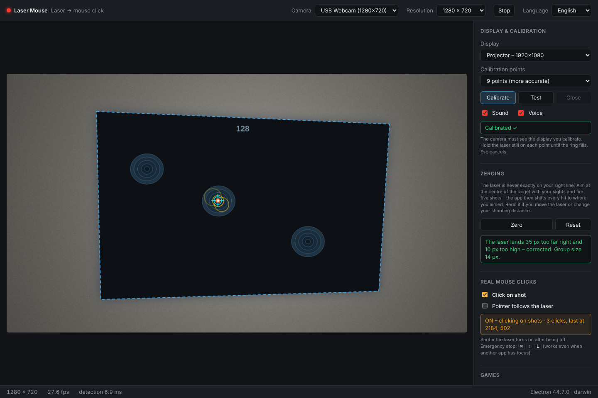

<sub>Laser Mouse watching a projected game: the dashed blue outline is the calibrated screen, the crosshair is the detected laser dot, and the yellow rings are the last shots. The panel on the right has two tabs: **Games & zeroing** (shown here) and **Settings**.</sub>

---

## How it works

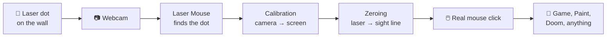

1. **Detect** – the webcam watches the wall. Laser Mouse looks for a small spot that is much brighter than everything around it, so faces, lamps and red objects don't fool it.
2. **Calibrate** – you point the laser at 4 or 9 targets on the screen. From that, the app knows how the camera's tilted view maps onto the real screen.
3. **Zero** – fire five shots while aiming with your sights. The app learns how far off the laser is mounted and corrects every shot from then on.
4. **Click** – every time the laser flashes on (a "shot"), the app moves the real mouse there and clicks.

---

## Features

- 🎯 **Laser → mouse click** on any screen or projector, in any application
- 🧠 **Robust detection** – a point detector that ignores faces, lamps and red clothing, plus "learn static spots" for LEDs and reflections
- 📐 **4- or 9-point calibration** with a live outline of the screen in the camera view
- 🔫 **Zeroing** – compensates for where the laser is mounted (taped to the barrel, laser cartridge, …)
- 🔊 **Eyes-free setup** – voice and sound guidance during calibration ("Point 2, top right"), so you can watch your sights instead of the screen
- 🖥️ **Multi-monitor** – choose which display receives the clicks
- 🕹️ **Built-in games** that launch full screen on the projector – *Gliding Targets*, *Clay Pigeons* (trap, skeet, sporting), *Shot Timer* with six drills and *Hunting Stand*, where safe, ethical shooting matters as much as the hit – with synthesized gunshot sounds (shotgun with pump action, pistol, rifle, laser)
- 🛑 **Emergency stop** – <kbd>⌘</kbd>+<kbd>⇧</kbd>+<kbd>L</kbd> turns mouse control off from anywhere
- 🌍 **Swedish and English** – Swedish by default; switch language in the toolbar (the games follow along)

---

## What you need

| | |
|---|---|
| 💻 **Computer** | A Mac (developed on Apple Silicon). Windows and Linux should work but are untested. |
| 📷 **Webcam** | Any USB webcam or the built-in one. 30 fps at 720p is plenty. |
| 📽️ **Screen** | A projector on a wall works best. A second monitor also works for testing; TVs are often too bright. |
| 🔴 **Red laser** | A low-power (< 1 mW) red pointer around 650 nm – or a 12-gauge/9 mm **laser training cartridge** that flashes when the firing pin strikes. |
| ➕ *Optional* | A **650 nm band-pass filter** in front of the webcam lens makes detection almost trivial. (A pair of brown sunglasses is a surprisingly good stand-in!) |

---

## Quick start

### 1. Install and run

You need [Node.js](https://nodejs.org/) 20 or later.

```bash
git clone <this repo> shooting-cinema
cd shooting-cinema/laser-mouse
npm install
npm start
```

On macOS you'll be asked for **camera** access the first time, and later for **Accessibility** access when you turn on mouse clicks (*System Settings → Privacy & Security → Accessibility → Electron*, then restart the app).

The app starts in Swedish – pick **English** in the **Språk** (*Language*) menu at the top right. Your choice is remembered, and games you launch from the app open in the same language.

### 2. Point the camera and tune detection

Aim the webcam at the wall or projector screen so it sees the whole picture. Open the **Settings** tab, turn on **Show mask** (under *View*) and point the laser: the pixels the app thinks are laser light turn green.

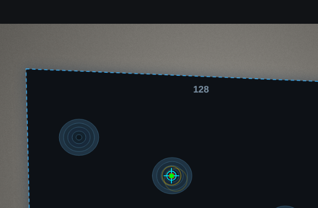

If something else lights up, raise **Contrast to surroundings**. If an LED or reflection keeps triggering, switch the laser off and press **Learn static spots** – the app watches for two seconds and ignores those spots from then on.

### 3. Calibrate

In the **Settings** tab, pick the display under **Display & calibration**, choose 4 or 9 points and press **Calibrate**. A target appears on that screen – hold the laser steady in the ring until the green arc fills, then move on to the next. A voice tells you where to aim, so you don't have to look at the screen.

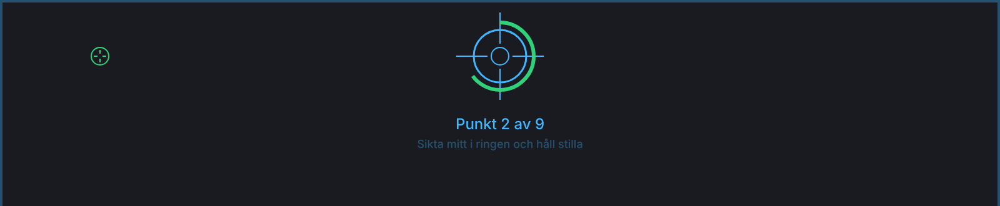

When it's done, a test overlay shows a crosshair wherever you point.

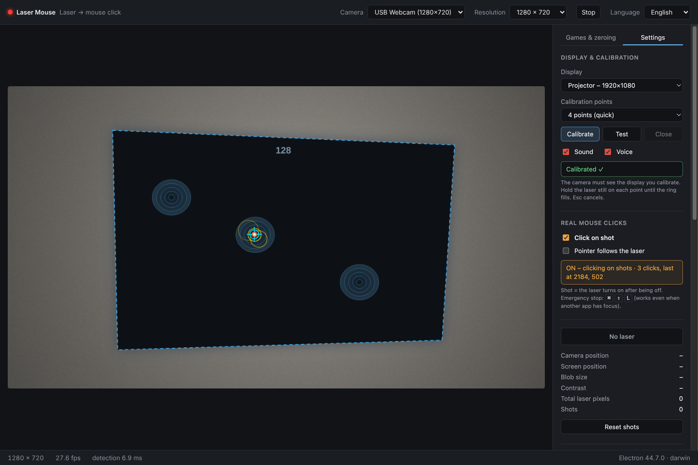

<sub>The **Settings** tab holds calibration, real mouse clicks, detection sensitivity and camera exposure.</sub>

### 4. Zero your laser

A laser taped to a barrel is never exactly in line with the sights. In the **Games & zeroing** tab, press **Zero**, aim at the centre of the target **with your sights**, and fire five shots. The app takes the median offset (one flinched shot won't ruin it) and corrects every shot from then on.

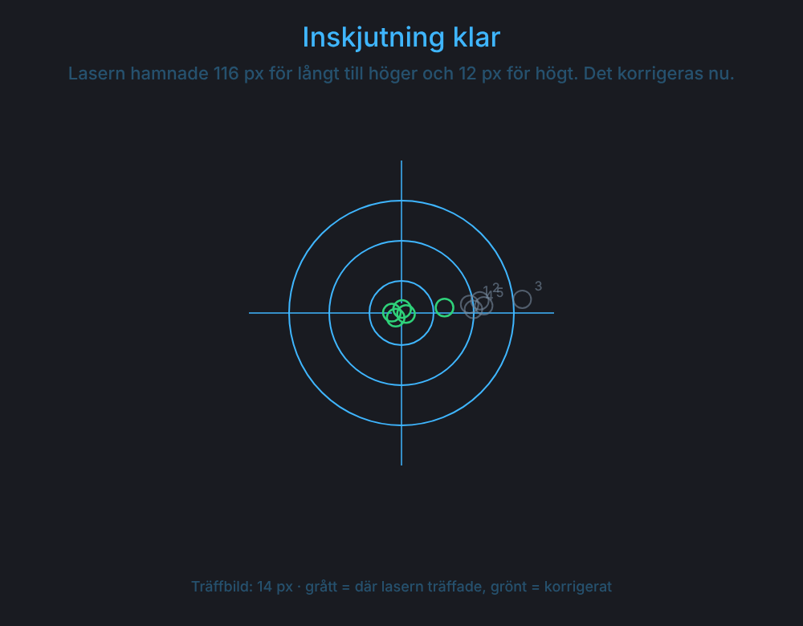

<sub>Grey = where the laser actually hit. Green = where those shots land after correction.</sub>

### 5. Shoot!

Make sure **Click on shot** is ticked (it is by default; *Settings* tab), then pick a game in the **Games & zeroing** tab and press **Start on selected display** – it opens full screen on your calibrated display. Every laser flash is now a mouse click.

> 🛑 Press <kbd>⌘</kbd>+<kbd>⇧</kbd>+<kbd>L</kbd> at any time to turn mouse control off.

---

## Games

### Gliding Targets

Targets glide across the screen – 60 seconds, score by ring (10 in the centre down to 5). Four modes: **Easy**, **Medium**, **Hard** (small targets that weave) and **Pop-up** (static targets that appear and vanish). Everything is chosen by shooting at it – no keyboard needed, not even to switch between Swedish and English.

| Menu | In play | Results |
|---|---|---|
| 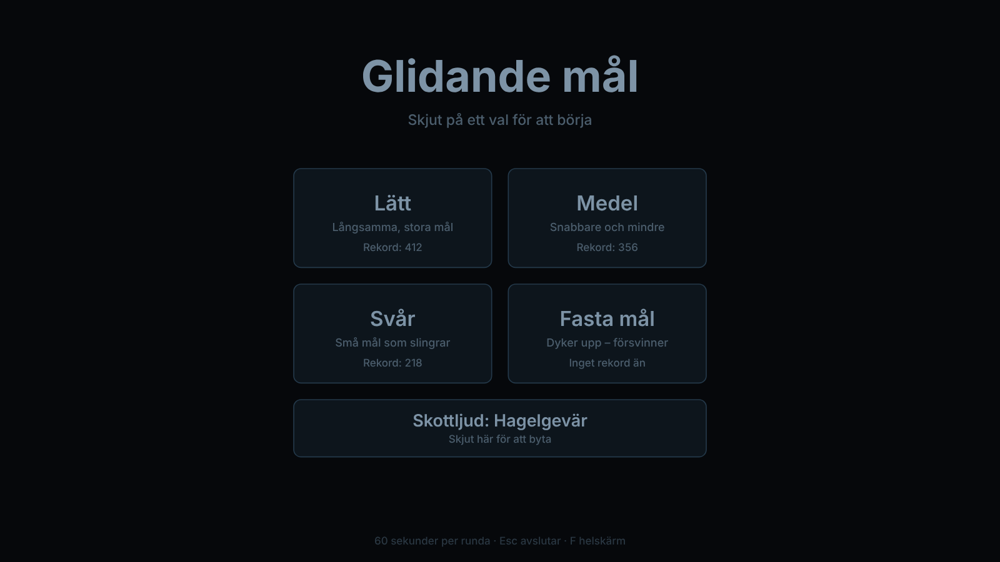 | 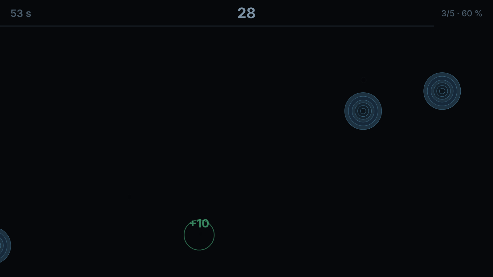 | 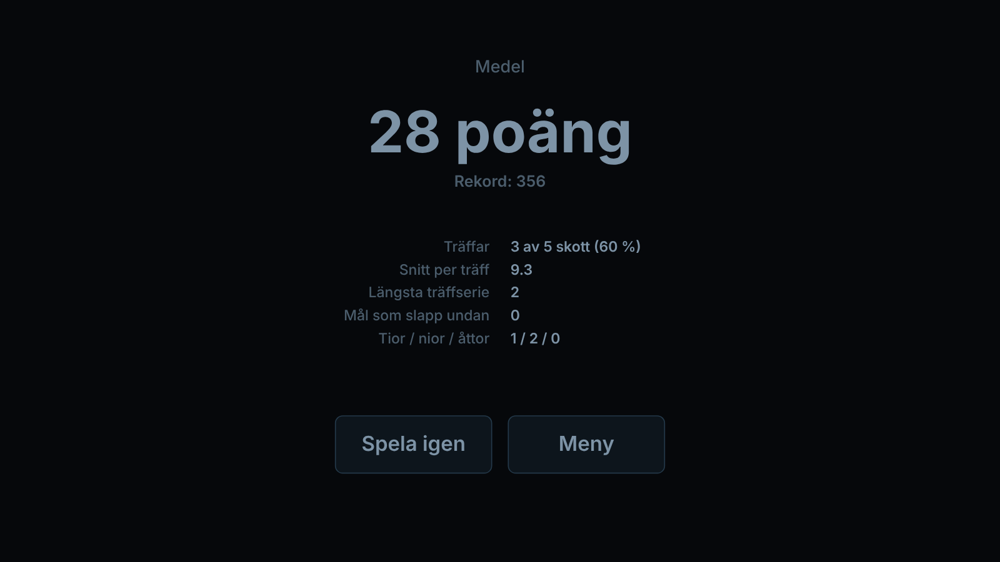 |

The graphics are deliberately dark and low in red, and the bullseye is the darkest part of the target – so the projector never blinds the camera and the laser dot stands out exactly where you want to hit. Pick your gunshot sound in the menu: a hefty shotgun with pump action, pistol, rifle, sci-fi laser – or silence.

### Clay Pigeons

Clays thrown in an arc, like the real thing. Three disciplines:

- **Trap** – clays fly away from you out of a bunker in front, shrinking as they go
- **Skeet** – crossing clays from a high house and a low house, with doubles
- **Sporting** – a mix: trap and skeet clays, doubles, tower clays dropping from above and "rabbits" bouncing along the ground

25 clays per round and **two shots per throw**, as with a double-barrelled shotgun – your score is how many you break, just like on the range. Each shot shows the outline of the shot pattern, so you can see whether you were ahead of or behind the clay. A centre hit turns the clay into a puff of dust: *Smoked!*

Clays are released automatically after a random delay – long enough to break open the gun and reload a laser cartridge – or, if you prefer, **call "Pull!"** and the microphone releases the clay.

| Menu | A double in the air |
|---|---|
| 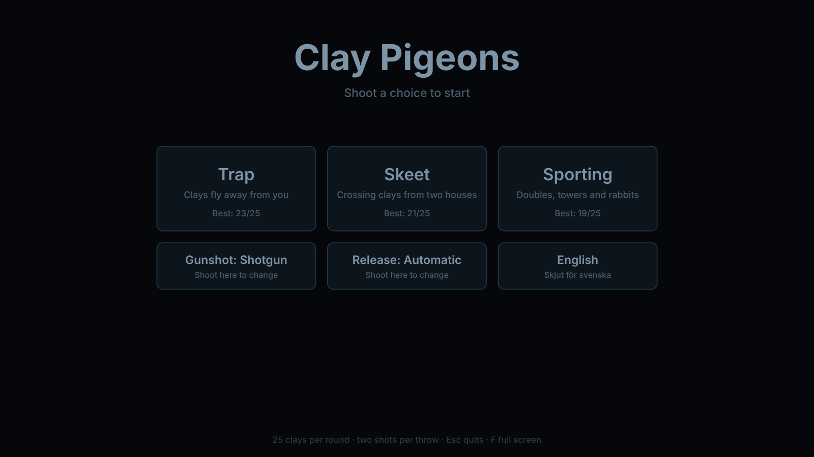 | 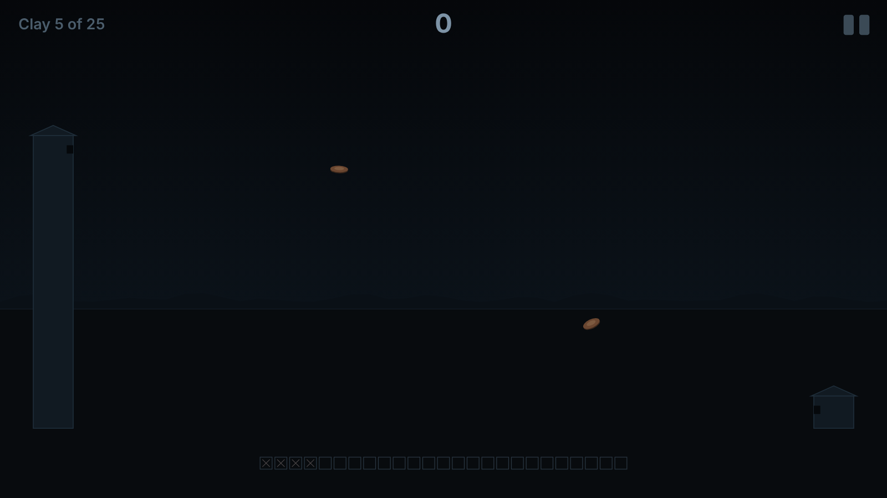 |

### Shot Timer & Drills

Measure and sharpen the basics, like with a real shot timer. A beep starts the clock, every shot is timed **and** placed – something an ordinary shot timer can't do – and a shot before the beep is a false start.

| Drill | What you do | What is measured |
|---|---|---|
| **Free timer** | Beep, then shoot as you like | First-shot time and splits |
| **Mount drill** | Gun lowered; on the beep, mount and hit – 10 reps | Average time to shot, hit rate |
| **Bill drill** | Six shots on one target, as fast as you can | Total time, splits, hits and points |
| **El Presidente** | Three targets, two shots each | Total time, hits and points |
| **Reaction** | One of five targets lights up – find it and hit it, 10 reps | Reaction time, correct-target rate |
| **Grouping** | Ten calm shots on a small target, no clock | Group size and where the group sits |

Every result is saved: the menu shows your best for each drill, and the results screen shows your personal best and a trend line of your last ten runs.

| Drills | Reaction | Results and trend |
|---|---|---|
| 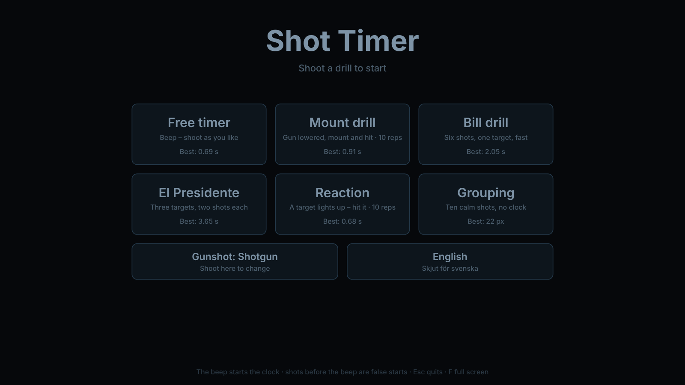 | 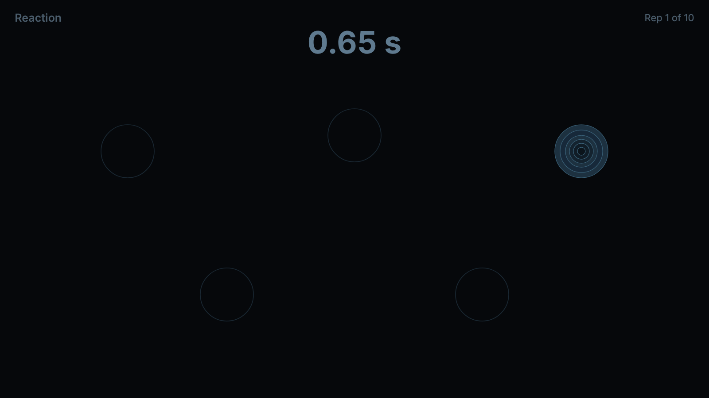 | 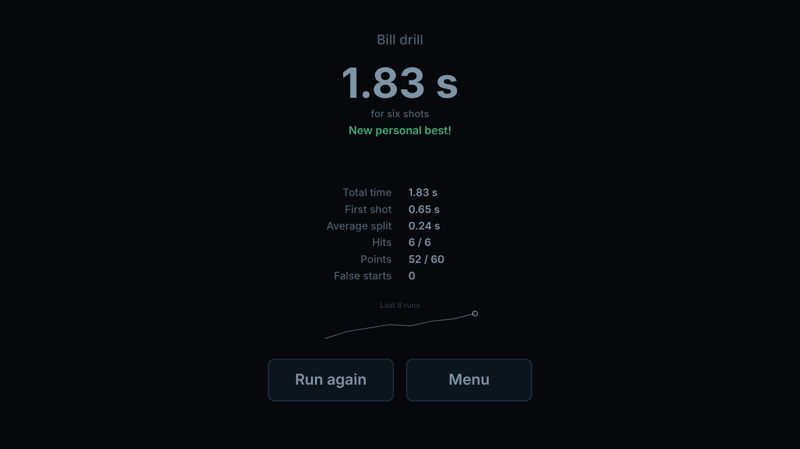 |

> Times measured through Laser Mouse include the camera delay (typically 0.05–0.1 s) – the same for every shot, so your progress is still comparable.

### Hunting Stand

Moose, roe deer, wild boar, fox, hare and flying birds pass your stand – and this time the hard part isn't only the hit, it's **deciding whether to shoot at all**. Every encounter is judged by good hunting ethics, and an unsafe shot costs more than a miss.

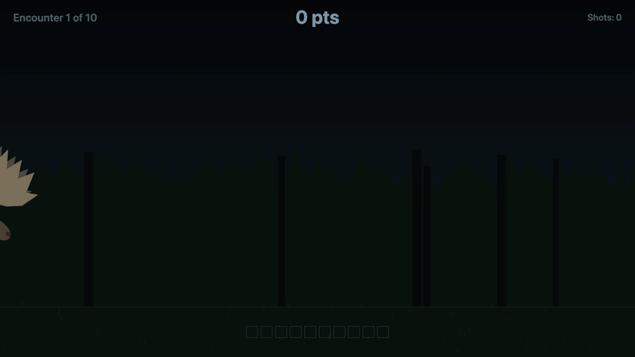

What the game checks, every time you pull the trigger:

| | |
|---|---|
| **Clear line of fire** | No branch in the way, and no vegetation hiding the animal – a boar rooting behind a bush has to step out first |
| **A safe backstop** | No rock behind the animal (ricochet), no ridge so the animal is skylined, no fellow hunter in an orange vest and no building in the line of fire. The hazard sits where the animal stops, so sometimes you simply have to wait until it walks on |
| **Young first** | Shoot the calf (or fawn) before the cow – never the mother first. She may have a calf you can't see yet. A sow with piglets is spared completely |
| **Know your target** | A hunting dog in an orange vest looks a lot like a fox, and a crane (protected) isn't a duck |
| **The right spot** | Aim behind the shoulder – heart and lungs. Head, neck and belly shots wound the animal and cost points |

Dropping an animal cleanly scores 10 (+3 if it stood still), letting a bad situation pass scores +5, a wounded animal costs 5 and an unsafe shot costs 10. After every encounter the game tells you *why* it was good or bad. Three stands – **Moose**, **Boar** (in dense vegetation) and **Mixed** (with birds) – ten encounters each, and the animals walk, trot or run past – sometimes stopping (anywhere), sometimes not at all – with anatomically drawn legs.

| Menu | A rock behind the moose | Calm and clean |
|---|---|---|
| 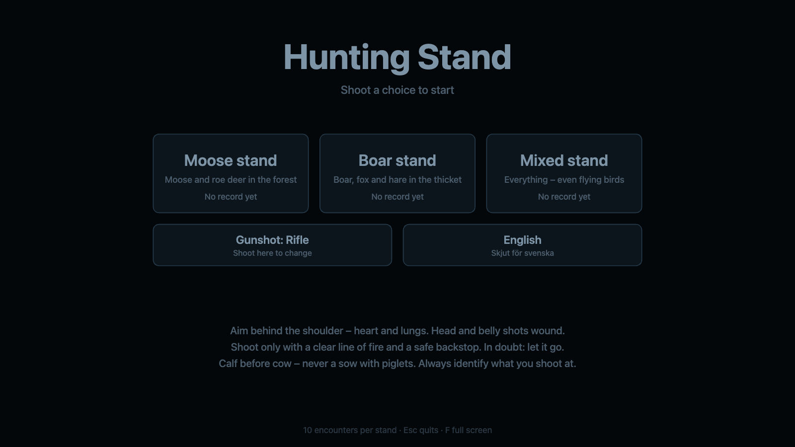 | 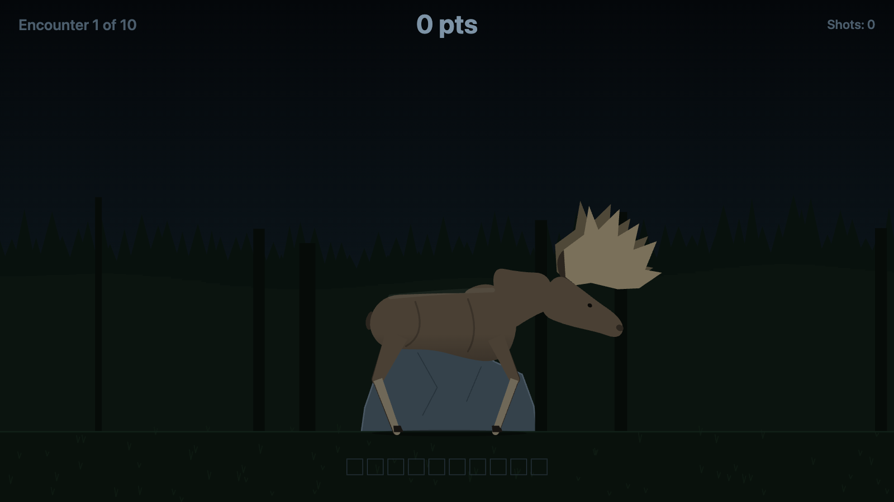 | 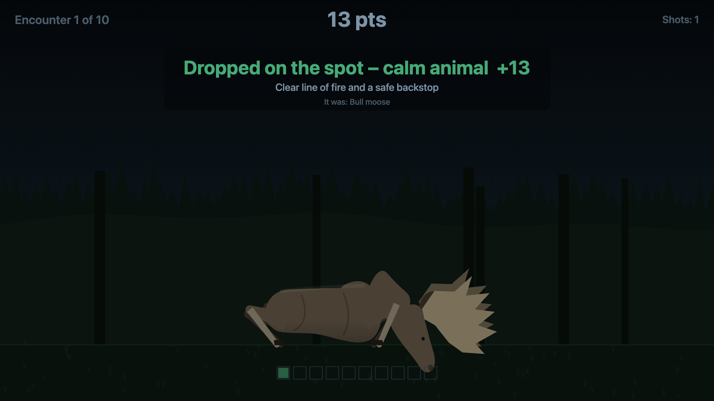 |

The same moose in front of that rock is an **unsafe shot** – the game explains the ricochet risk:

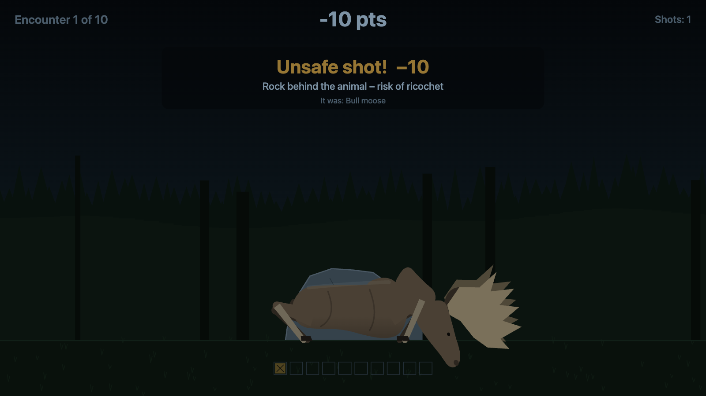

### Bring your own

Because the laser becomes an ordinary mouse click, you're not limited to the built-in games. Try a browser game, a drawing app, or a classic shooter. New games are just a folder with an `index.html` – see [docs/TECHNICAL.md](docs/TECHNICAL.md#writing-a-game).

---

## Tips for the best results

- **Dark is good.** Bright, white backgrounds wash out the laser dot. Dark scenes work far better.
- **Projector over TV.** TVs and monitors emit a lot of light and reflect the laser poorly. A projector on a matte wall is ideal.
- **Filter the camera.** A 650 nm band-pass filter (or brown sunglasses) in front of the lens leaves the laser as the only bright thing in view.
- **Don't move the camera.** If you do, re-calibrate (and re-learn static spots).
- **Re-zero** if you move the laser or change your shooting distance.

---

## ⚠️ Safety

- When using a real firearm for dry-fire practice: **make sure it is unloaded**, keep **all live ammunition out of the room**, and use snap caps or a laser training cartridge to protect the firing pins.
- Use a **low-power laser** and never point it at people's or animals' eyes.
- Mouse control can click on anything on the chosen screen. Keep the emergency stop (<kbd>⌘</kbd>+<kbd>⇧</kbd>+<kbd>L</kbd>) in mind.

---

## Project layout

| Folder | What's inside |
|---|---|
| [`laser-mouse/`](laser-mouse/) | The Electron app: webcam, detection, calibration, zeroing, mouse control |
| [`games/`](games/) | Games and drills to shoot at – Gliding Targets, Clay Pigeons, Shot Timer and Hunting Stand; plain web pages that react to mouse clicks |
| [`docs/`](docs/) | [Technical documentation](docs/TECHNICAL.md) and screenshots |

Curious how the detection, calibration maths or mouse control work? Read **[docs/TECHNICAL.md](docs/TECHNICAL.md)**.
