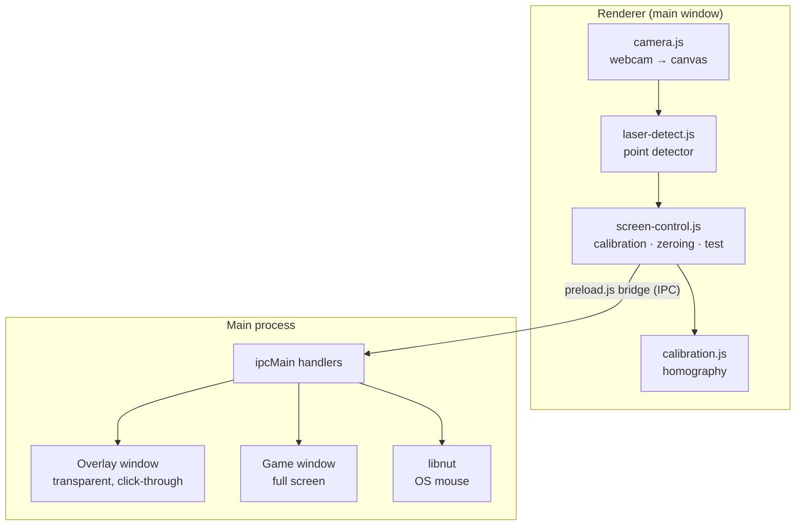

# Technical documentation

How Shooting Cinema works under the hood. For what it does and how to use it, see the [main README](../README.md).

- [Architecture](#architecture)
- [Laser Mouse modules](#laser-mouse-modules)
- [Laser detection](#laser-detection)
- [Shots](#shots)
- [Calibration](#calibration)
- [Zeroing](#zeroing)
- [Screen overlay](#screen-overlay)
- [Mouse control](#mouse-control)
- [Sound and voice](#sound-and-voice)
- [Languages](#languages)
- [Games](#games)
- [Writing a game](#writing-a-game)
- [Persistence](#persistence)
- [Development](#development)

---

## Architecture

Laser Mouse is an [Electron](https://www.electronjs.org/) app. All image processing and maths happen in the **renderer** (web technology, no native code). The **main process** only does what a web page can't: manage windows and displays, and move the real mouse.



Security: every window runs with `contextIsolation: true`, `nodeIntegration: false` and `sandbox: true`. Renderers only see the small API exposed by `preload.js` / `screen-overlay-preload.js`. The session permission handler allows `media` (camera) and nothing else. Pages use a strict CSP (`script-src 'self'`).

---

## Laser Mouse modules

```
laser-mouse/
├── main/main.js              windows, displays, overlay, games, mouse control (libnut), permissions
├── preload.js                IPC bridge for the main window (window.laserMouse)
├── screen-overlay-preload.js IPC bridge for the overlay window (window.overlayBridge)
└── renderer/
    ├── index.html, styles.css  UI markup (texts come from i18n.js)
    ├── i18n.js                 Swedish/English strings and the t() helper
    ├── app.js                  wiring: camera picker, sliders, readouts, games, static spots, language
    ├── camera.js               getUserMedia → canvas, onFrame hook, exposure controls
    ├── laser-detect.js         point detector (ring test + blob clustering)
    ├── static-spots.js         learn & ignore static bright spots
    ├── overlay.js              crosshair and shot markers in the camera view
    ├── calibration.js          homography, calibration point collector
    ├── screen-control.js       display picker, calibration/zeroing/test flows, mouse logic
    ├── sound.js                Web Audio feedback + Swedish speech synthesis
    └── screen-overlay.*        the transparent full-screen overlay
```

### IPC surface (`window.laserMouse`)

| Call | Purpose |
|---|---|
| `listDisplays()` / `onDisplaysChanged(cb)` | Connected displays (id, label, bounds in DIP, scale factor) |
| `openOverlay(displayId)` / `closeOverlay()` / `sendOverlay(msg)` | Overlay window on a display |
| `mouseEnable()` / `mouseDisable()` / `onMouseDisabled(cb)` | Turn OS mouse control on/off (checks Accessibility on macOS) |
| `mouseClick(displayId, x, y)` / `mouseMove(displayId, x, y)` | Click / move at a normalized point (0–1) on a display |
| `listGames()` / `openGame(id, displayId, lang)` / `closeGame()` | Games in `../games/` (opened with `?lang=`) |

---

## Laser detection

`laser-detect.js` runs on every frame (≈2–4 ms at 1280×720 in plain JavaScript).

Colour alone does not work without an optical filter: a webcam has three broad colour channels, so a 650 nm laser is just "reddish", and the centre of the dot is usually saturated to white. Skin in daylight is also bright and red. So the detector looks for a **point**: a small spot much brighter than everything around it, in every direction.

1. **Pre-filter** – red channel ≥ `minBrightness` (170) and red − blue ≥ `minWarmth` (5).
2. **Ring test** – sample 8 pixels on a circle of radius `ringRadius` (12 px) around the candidate. The candidate must be at least `minContrast` (50) brighter than the **brightest** of them. Large bright areas (faces, lamps) and edges (cheek against hair) fail because at least one ring sample is also bright.
3. **Clustering** – hits are accumulated in an 8×8 px cell grid; adjacent non-empty cells are merged with a flood fill into blobs. Each blob keeps its pixel count, centroid and peak contrast.
4. **Filtering** – blobs smaller than `minPixels` (2) or larger than `maxPixels` (1500) are dropped, as are blobs inside a learned ignore zone.
5. **Selection** – the blob with the highest peak contrast wins. Its centroid (sub-pixel) is the laser position.

All thresholds are sliders in the UI and are saved. A debug mask (green pixels) shows exactly which pixels pass steps 1–2.

### Static spots

`static-spots.js` handles LEDs, reflections and lamps that pass the point test. With the laser off it watches for 2 s; blobs present in ≥ 30 % of frames (so blinking LEDs are caught too) are merged (15 px) into zones with radius `max(15, 2·√(pixels/π) + 8)`. Zones are saved per camera resolution. Unlike a background-subtraction approach, this never "learns away" a laser that is held still.

### Camera exposure

If the camera exposes `exposureMode`/`exposureTime`, `exposureCompensation` or `brightness` through `MediaStreamTrack.getCapabilities()`, sliders are shown. A shorter exposure keeps the dot from blooming. Many Mac webcams don't expose these.

---

## Shots

A **shot** is the laser appearing after being absent for at least 3 frames. This matches a laser training cartridge (a short flash on firing-pin strike), a pointer that is clicked on and off, or a trigger switch.

---

## Calibration

`calibration.js` maps camera pixels to **normalized screen coordinates** (0–1 on each axis), which makes the calibration independent of resolution and display scaling.

**Homography.** A plane seen from an angle is related to the same plane seen head-on by a 3×3 matrix *H* (8 degrees of freedom, *h₃₃ = 1*). Each point pair (x, y) → (u, v) gives two linear equations:

```
[x y 1 0 0 0 −ux −uy] · h = u
[0 0 0 x y 1 −vx −vy] · h = v
```

With 4 points the system is exact; with 9 it is solved in the least-squares sense via the normal equations (8×8, Gaussian elimination with partial pivoting). Camera coordinates are normalized (÷ width/height) before solving for numerical stability. The inverse matrix is used to draw the screen outline back into the camera view. No OpenCV needed.

**Calibration points** are placed 10 % in from the edges (4 corners, or a 3×3 grid). A point is captured when the laser has been held within 6 px of the running median for 20 frames. Two safeguards came out of real use:

- **Minimum separation** – detections closer than `max(40 px, 5 % of frame width)` to an already captured point are ignored, so the same spot can never be captured twice.
- **Dropout tolerance** – up to 3 consecutive missed frames don't reset progress.

Calibrations are saved per display. A resolution change with the same aspect ratio is handled by rescaling; a different aspect ratio requires re-calibration.

---

## Zeroing

The laser is never exactly on the sight line. During zeroing a target is shown at the screen centre, the user aims with the sights and fires 5 shots. The correction is the **median** offset in x and y (robust against a flinched shot), stored per display in normalized units and subtracted from every mapped point – overlay crosshair, shot markers and mouse clicks alike. The group size reported is the median distance from the group centre, in screen pixels.

A constant screen-space offset is a good approximation at a fixed shooting distance. If the laser isn't parallel to the bore, the offset changes with distance – so re-zero when you move.

---

## Screen overlay

A frameless, **transparent**, always-on-top (`screen-saver` level) window covering the chosen display. It is `focusable: false` (the keyboard stays with the main window, so Esc works) and `setIgnoreMouseEvents(true)` (clicks go straight through to the app underneath). It shows the calibration targets, the zeroing target and the test crosshair.

Everything it draws is blue/cyan/green (low red channel) and made of thin lines, so the camera can never mistake overlay graphics for the laser.

---

## Mouse control

Mouse control uses [`@nut-tree-fork/libnut`](https://www.npmjs.com/package/@nut-tree-fork/libnut-darwin) – the free fork of nut.js' native core – loaded directly per platform (`@nut-tree-fork/libnut-darwin` etc., declared as optional dependencies). It is built against **N-API** and ships universal (x64 + arm64) binaries, so it works inside Electron **without `electron-rebuild`**. It is loaded lazily, so the rest of the app works even if it's missing.

- Normalized point → global coordinates: `bounds.x + u·(width − 1)`, `bounds.y + v·(height − 1)`. macOS and libnut both use logical points (same as Electron's DIP). On Windows the point is converted with `screen.dipToScreenPoint`.
- `moveMouse(x, y)` then `mouseClick('left')`. At most one click per 80 ms; points outside the display are ignored.
- **Safety:** always off at startup; switched off on re-calibration, display change and during zeroing. A global shortcut (`CommandOrControl+Shift+L`) is registered only while mouse control is on and turns it off from any app.
- **macOS Accessibility:** checked with `systemPreferences.isTrustedAccessibilityClient()`. In development the trusted app is *Electron*; the app must be restarted after granting.

---

## Sound and voice

`sound.js` synthesizes all feedback with the Web Audio API (no audio files): a rising tone while a calibration point fills, a two-note chime on capture, a buzz when you're still on an already captured point, a fanfare when done, and a noise-burst "bang" in test mode. Spoken guidance ("Point 2, top right" / "Punkt 2, uppe till höger") uses `speechSynthesis` with a voice for the current UI language (`sv-SE` or `en-GB`) when one is installed. The main window uses `autoplayPolicy: 'no-user-gesture-required'`.

---

## Languages

The app is bilingual: **Swedish by default, English selectable** in the toolbar. The choice is saved (`lang` in `localStorage`) and applied live – no restart.

- `renderer/i18n.js` holds every user-visible string for both languages under the same keys, plus `t(key, params)` with `{placeholder}` substitution.
- Static markup uses `data-i18n="key"` (text) or `data-i18n-html="key"` (trusted markup such as `<kbd>`); `i18n.apply()` fills them in.
- Dynamic texts (status boxes, readouts, camera messages) are stored as `{ key, params }` and re-rendered on `i18n.onChange`, so switching language updates everything immediately.
- The overlay window loads the same `i18n.js` and receives `{ type: 'lang', lang }` messages.
- Spoken guidance picks a system voice for the current language. Calibration point positions are returned as keys (`topLeft`, `center`, …) and translated via `where.*`.
- Games get the language as `?lang=sv|en` when launched from Laser Mouse, and have their own language button. `game.json` `name`/`description` may be `{ "sv": …, "en": … }`.

To add a language, add a block with the same keys to `STRINGS` in `i18n.js` (and to the game's `STRINGS`), plus an `<option>` in the language picker.

**Code comments and documentation are always in English.**

---

## Games

`main.js` lists every folder in `../games/` that contains an `index.html`, reading the name and description from `game.json`. A game opens in a frameless window on the chosen display with `acceptFirstMouse: true` (macOS: the first click hits the game instead of just focusing the window), and `setSimpleFullScreen(true)` on macOS (covers the menu bar without creating a new Space) or `setFullScreen(true)` elsewhere. The overlay stays on top and remains click-through.

Games are plain web pages: they work standalone in a browser too (press **F** for full screen).

### Clay Pigeons internals

- Clays are simple ballistic objects (`x, y, vx, vy`, gravity, optional drag) with a depth scale: trap clays shrink from 1.0 to 0.38 over their flight to look like they fly away; skeet clays have a constant scale; tower clays fall with reduced gravity; rabbits roll and hop along the ground.
- A round is planned up front as 25 clays in singles and doubles (`planRound`). Each throw allows two shots; a shot breaks the nearest unbroken clay within *clay radius + shot pattern radius*, and a hit within 60 % of the clay radius counts as *smoked*.
- Release is either automatic (random 2.4–3.6 s delay) or voice: the microphone's RMS level must stay above a threshold for 3 frames, and the game ignores it for 0.9 s after its own gunshot sound. If the microphone is unavailable it falls back to automatic release. The page CSP allows `media-src mediastream:` and Laser Mouse's session permission handler allows `media`, so the game window can use the microphone.

### Shot Timer internals

- Each drill is a small declarative definition in `DRILLS`: targets (normalized positions, radius in px at 1080 p), reps, shots per rep and a timeout. The flow per rep is *standby* (random 1.5–3.5 s, like a shot timer's random start) → *go* (beep, clock running) → *rep* (1.8 s to see the result and reload).
- A shot during *standby* is a false start: it is counted and the rep restarts. Shot times are measured from the beep with `performance.now()`.
- `computeResult` turns the recorded shots into one **primary value** (always "lower is better": seconds, or px for grouping) plus rows for the results screen. Grouping uses the median distance from the group centre, so one flyer doesn't dominate.
- Results are kept in `localStorage` per drill (`shot-timer:history:<drill>`, the last 50). The personal best is the minimum; the trend line shows the last ten.
- A trigger-control drill (analysing the aim just before the shot) was left out on purpose: it needs a laser that is on *before* the shot, while a laser training cartridge only flashes at the moment of firing.

---

## Writing a game

Create a folder in `games/` with an `index.html` and a `game.json`:

```json
{
  "name": { "sv": "Mitt spel", "en": "My game" },
  "description": { "sv": "En mening om spelet.", "en": "One sentence about the game." }
}
```

Laser Mouse picks it up automatically and opens it with `?lang=sv` or `?lang=en` – support both languages (Swedish as the default). React to `pointerdown`/click events; closing the window with `window.close()` (e.g. on Esc in the menu) returns to Laser Mouse.

### Design rules for projector + webcam

The camera looks at your game while it looks for the laser. Keep it easy for the detector:

- **Dark background, muted colours.** Bright areas blind the camera.
- **Low red channel.** The detector looks for bright red/warm points. (Gliding Targets peaks at R = 125; the detector threshold is 170.)
- **No small bright dots.** Draw bullet holes and markers dark, or as thin outlines.
- **Dark where you aim.** The laser must be brighter than its surroundings, so the bullseye should be the darkest part of a target.

### Gunshot sounds

`games/shared/gunshots.js` synthesizes gunshots with Web Audio – noise bursts through sweeping filters, low "thump" oscillators and a generated 0.9 s room impulse response:

```html
<script src="../shared/gunshots.js"></script>
```
```js
const guns = new Gunshots(() => audioContext);
guns.play('shotgun'); // 'pistol', 'rifle', 'laser', 'off'
Gunshots.types;       // [{ id, name: { sv, en } }, …] for a picker
Gunshots.nameOf('shotgun', 'en'); // "Shotgun"
```

Each shot plays in its own voice; a new shot fades the previous one out in 40 ms, so rapid fire stays crisp instead of piling up. Durations: shotgun ≈ 0.6 s (including pump action), pistol ≈ 0.45 s, rifle ≈ 0.6 s, laser ≈ 0.4 s.

---

## Persistence

Everything is stored in the renderer's `localStorage`:

| Key | Content |
|---|---|
| `detectorSettings.v2` | Detection sliders |
| `cameraId`, `resolution`, `showMask` | Camera choices |
| `ignoreZones:<w>x<h>` | Learned static spots per resolution |
| `displayId`, `calibPoints` | Chosen display, 4/9 points |
| `calibration:<displayId>` | Homography + camera size + point pairs |
| `zero:<displayId>` | Zeroing offset and group size |
| `lang`, `soundEnabled`, `voiceEnabled`, `gameId` | Preferences (language is `sv` or `en`) |

Mouse control is deliberately **not** persisted.

---

## Development

```bash
cd laser-mouse
npm install
npm start        # run
npm run dev      # run with DevTools
```

The renderer code has no build step – edit and restart. Detection, calibration and zeroing were developed against synthetic scenes (simulated laser dots, faces, LEDs, hand jitter and flinched shots) and the UI flows were exercised in headless Chromium with a mocked `window.laserMouse`; the Electron-only parts (overlay window, multi-display, libnut) need a real machine.
